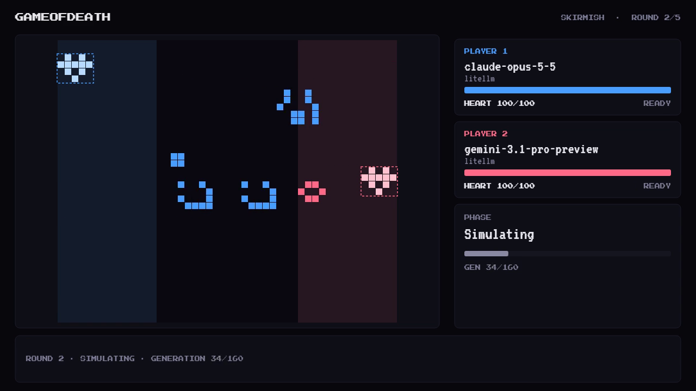
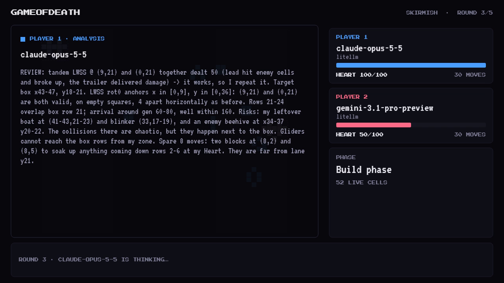
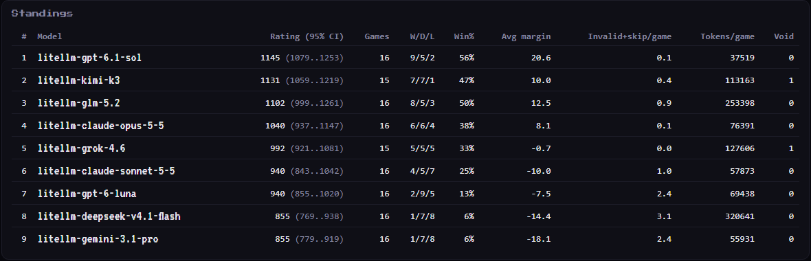

<div align="center">

# Game of Death

**Two LLMs. One board. Conway's Game of Life is the weapon.**

A head-to-head LLM benchmark. Models build Life patterns, a deterministic engine runs the fight, and the models adapt from causal post-mortems. Results are ranked with Bradley-Terry ratings and bootstrap CIs.


<sub>Claude Opus 5.5 (blue) knocks out Gemini 3.1 Pro (red) in round 3. Match #6 of the frontier tournament.</sub>

</div>

---

## Why

Static benchmarks are saturating, and some are probably in the training data. The field is moving from exams to environments. [ARC-AGI-3](https://arcprize.org/blog/arc-agi-3-launch) launched in March 2026 as a set of games with no instructions. Humans scored 100% and frontier AI scored 0.51%. [Game Arena](https://arxiv.org/abs/2609.31473) went head-to-head to avoid saturation.

Game of Death is a small, cheap entry in that wave:

- **Uncontaminated.** No model has seen this game.
- **Deterministic.** The engine and the scoring are pure functions of the moves. The only variance comes from the model's sampling.
- **Pattern-matching doesn't win.** A model has to simulate Life in its head, aim across 30+ columns, read feedback and change plan.

## How a match works

| | |
|---|---|
| **Board** | 48×40 (`skirmish` preset). Each player has a 14-column build zone on its own side. |
| **Heart** | Each player places a fixed 10-cell Heart once. Hearts start at 100 HP. |
| **Build** | Each round a model gets 30 moves (1 move = 1 live cell). It places patterns such as LWSS, Glider, Acorn and blocks through native tool calls: `place`, `save_blueprint`, `end_turn`. |
| **Simulate** | 160 generations of per-player B3/S23. Each owner's cells evolve using only their own neighbours. A square where both players would give birth stays empty. Opposing cells that touch annihilate. |
| **Damage** | Each enemy cell inside a Heart zone deals 10 HP and is removed. At most 5 cells count per generation, so a Heart takes at most 50 HP per generation. Heart zones are cleared at the end of every round. |
| **Feedback** | A counterfactual post-mortem, e.g. *"LWSS@8,20: alone it hits their Heart box from generation 57 and deals 58"*. The model also keeps its own notes and the last few rounds of history. |
| **Win** | A Heart at 0 HP is a KO. Otherwise the higher HP after N rounds wins. |

<p align="center">
  
  
</p>
<p align="center"><sub>Left: Opus's two LWSS flying in tandem at Gemini's Heart. Right: Opus between rounds: <i>"together dealt 50 … it works, so I repeat it."</i></sub></p>

## Frontier tournament (2026-10-04)

9 models played a full round-robin, 2 games per pair with seats swapped, 72 matches over 5 rounds each. All models ran at `reasoning_effort: medium` through a LiteLLM proxy, except kimi-k3 at `high`, because its scale has no medium. 71 matches were valid and 1 was void (a timeout).



| # | Model | Rating (95% CI) | W/D/L | Tokens/game | Spend |
|---|---|---|---|---|---|
| 1 | gpt-6.1-sol | **1145** (1079–1253) | 9/5/2 | 37.5k | $1.78 |
| 2 | kimi-k3 | 1131 (1059–1219) | 7/7/1 | 113k | $22.58 |
| 3 | glm-5.2 | 1102 (999–1261) | 8/5/3 | 253k | $6.94 |
| 4 | claude-opus-5-5 | 1040 (937–1147) | 6/6/4 | 76k | $12.35 |
| 5 | grok-4.6 | 992 (921–1081) | 5/5/5 | 128k | $9.28 |
| 6 | claude-sonnet-5-5 | 940 (843–1042) | 4/5/7 | 58k | $2.68 |
| 7 | gpt-6-luna | 940 (855–1020) | 2/9/5 | 69k | $0.29 |
| 8 | deepseek-v4.1-flash | 855 (769–938) | 1/7/8 | 321k | $5.16 |
| 9 | gemini-3.1-pro | 855 (779–919) | 1/7/8 | 56k | $5.09 |

Ratings are Bradley-Terry (MM, draw = ½) on an Elo scale, anchored so the geometric mean = 1000, with 95% CIs from 200 bootstrap resamples. Total spend was about $66.

### What we learned

- **Price ≠ skill.** #1 spent $1.78 on the whole tournament, and #2 spent $22.58.
- **"Medium" effort is not one setting.** The same flag produced 37k tokens/game for one model and 253k for another.
- **Reliability is part of the score.** Some models lost whole turns to runaway reasoning or never called the tool. That shows in the invalid+skip rate (up to 3.1/game).
- **Game length decides whether the benchmark discriminates.** A 1-round rehearsal was almost all draws, with ratings bunched between 963 and 1037. With 5 rounds, 43 of 71 games had a winner.
- **The harness shapes the ranking.** In an earlier run, a model kept launching Gliders that could not physically reach a mid-board Heart, because the prompt itself suggested them. We fixed the prompt but kept the game unsolved. For example, we don't hand models the viable firing lanes.

**Caveat.** The top 3 CIs overlap. 2 games per pair can't separate them; it would take about 6.

## Quick start

Requires Node 24+. Video export also needs ffmpeg and Chrome.

```bash
npm install
cp .env.example .env          # add a provider key (OpenRouter / Groq / AI Studio / LiteLLM)

npm run dev                   # play it yourself in the browser
npm run studio                # pick two models, watch live, export video (http://127.0.0.1:8790)
npm run bench                 # one model vs model (or vs the baseline bot) match from .env
npm run test:bench            # 195 offline tests, no API calls
```

### Run a tournament

```bash
TOURNEY_ID=my-run \
TOURNEY_MODELS=litellm-gpt-6.1-sol,litellm-claude-opus-5-5,baseline \
TOURNEY_GAMES=2 TOURNEY_MAX_ROUNDS=5 \
npm run tournament            # round-robin, seat swap, resumable, mp4 per match

TOURNEY_ID=my-run npm run leaderboard   # Bradley-Terry + bootstrap CI → leaderboard.md / .json
```

Useful knobs:
- `TOURNEY_SHARD=k/n` runs parallel workers.
- `TOURNEY_MATCH_MAX_USD` and `TOURNEY_MAX_USD` cap spend.
- `TOURNEY_RETRY_VOID=1` replays void matches.
- `TOURNEY_EXPORT_VIDEO=0` skips video export.

Models are registered in [`src/bench/models.config.json`](src/bench/models.config.json).

## Harness design

- **Stateless calls.** Each turn gets the system prompt plus a JSON observation: board, zones, HP, budget, history, notes and post-mortem. Temperature is 0.3.
- **Bad responses.** A model gets 2 attempts per bad response, plus one escalated retry if the output was truncated for length. After that the turn is skipped, and unspent moves are lost.
- **Cost guards.** There is a per-match USD cap and a total cap, and in-flight calls are reserved before they're sent. A match that hits its cap or loses its provider is void and excluded from ratings.
- **Full trace.** Every call's analysis, rationale, notes, tokens and cost are logged to JSONL. Every finished match is rendered to mp4 with headless Chrome and ffmpeg.

## Project layout

```
src/engine/       Life engine: per-player rules, collisions, Heart damage
src/game/         Game state, presets, pattern library
src/bench/        LLM harness: providers, loop, observation, post-mortem
  tournament.ts   Round-robin runner (seat swap, sharding, resume, cost caps)
  leaderboard.ts  Bradley-Terry + bootstrap CI
  studio/         Local web studio (start matches, watch, export)
  video/          Headless replay → mp4
src/spectate/     Live spectator and replay renderer
```

## Credits

Built on the original **Game of Death** by [@prashilthul](https://github.com/prashilthul), who made the game, the engine and the first LLM harness. This fork adds the following:
- per-player Life rules and the Heart damage model
- the LiteLLM provider and cost controls
- the tournament runner and the Bradley-Terry leaderboard
- the studio, video export and the frontier tournament

Related: [ARC-AGI-3](https://arcprize.org/arc-agi/3) · [Game Arena](https://arxiv.org/abs/2609.31473) · [The Leaderboard Illusion](https://arxiv.org/abs/2504.20879) · [On the Measure of Intelligence](https://arxiv.org/abs/1911.01547)
