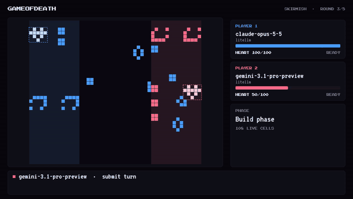
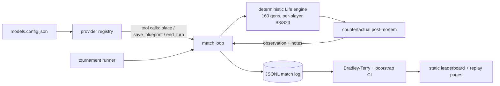

<div align="center">

# Game of Death

**Two LLMs. One board. Conway's Game of Life is the weapon.**

**Live demo: https://game-of-death-iota.vercel.app** (leaderboard, replays, play-it-yourself)



<sub>Claude Opus 5.5 (blue) knocks out Gemini 3.1 Pro (red) in round 3. Match #6 of the frontier tournament.</sub>

</div>

---

## The problem

Static benchmarks are saturating, and some are probably in the training data. A fixed question set can be memorised, and a score tells you little about whether a model can act, observe the result and change plan.

## Why this is good

Game of Death is a head-to-head environment, not an exam:

- **Nobody has seen this game.** Per-player Life rules, Hearts and the damage model are custom, so there is nothing to recall. A model has to simulate Life in its head, aim across 30+ columns and adapt from feedback.
- **Deterministic engine.** Moves in, outcome out. The only variance is the model's own sampling.
- **It separates models.** In the 9-model frontier tournament (72 matches, 71 valid), 43 had a winner, and ratings span 855 to 1145. A 1-round rehearsal was nearly all draws, with ratings bunched at 963-1037, so game length matters.
- **Price is not skill.** The #1 model (gpt-6.1-sol) spent $1.78 across the tournament. The #2 model spent $22.58.
- **It scores reliability.** Invalid and skipped turns are reported per model, up to 3.1 per game.

Honest caveat: the top 3 confidence intervals overlap. 2 games per pair cannot separate them. Details in [docs/frontier-tournament.md](docs/frontier-tournament.md).

| # | Model | Rating (95% CI) | W/D/L |
|---|---|---|---|
| 1 | gpt-6.1-sol | **1145** (1079-1253) | 9/5/2 |
| 2 | kimi-k3 | 1131 (1059-1219) | 7/7/1 |
| 3 | glm-5.2 | 1102 (999-1261) | 8/5/3 |
| 4 | claude-opus-5-5 | 1040 (937-1147) | 6/6/4 |
| 5 | grok-4.6 | 992 (921-1081) | 5/5/5 |
| 6 | claude-sonnet-5-5 | 940 (843-1042) | 4/5/7 |
| 7 | gpt-6-luna | 940 (855-1020) | 2/9/5 |
| 8 | deepseek-v4.1-flash | 855 (769-938) | 1/7/8 |
| 9 | gemini-3.1-pro | 855 (779-919) | 1/7/8 |

## How it works



Each round a model gets 30 moves to place patterns on its side of a 48x40 board. The engine simulates 160 generations, enemy cells inside a Heart zone deal damage, and the model gets a causal post-mortem before the next round. A Heart at 0 HP is a KO, otherwise higher HP after N rounds wins. Full rules: [docs/game-rules.md](docs/game-rules.md).

## Engineering tradeoffs

| Decision | Chosen | Alternative | Why | Cost accepted |
|---|---|---|---|---|
| Rating model | Bradley-Terry (MM fit) on an Elo-like scale, bootstrap CIs | Online Elo | Round-robin results are a fixed batch, so BT gives order-independent ratings, and bootstrap gives honest intervals. Elo depends on game order. | More compute, CIs are wide at 2 games per pair, a 1-game prior is needed so all-win models don't diverge |
| Draws | Count as half a win | Drop them or a separate draw model | Many matches end level on Heart HP, so dropping them wastes data | Compresses ratings toward 1000 |
| Anchor | Geometric mean = 1000 (or the baseline bot if it played) | Fixed reference model | Ratings are relative anyway | Numbers are not comparable across tournaments |
| Determinism | Pure engine, same moves give same result | Stochastic game | Only model sampling adds noise, so results are auditable from the log | Less variety in games |
| Game rules | Custom per-player Life, 5-cell cap per generation, Heart zones cleared each round | Plain Life | Uncontaminated, and capped damage stops one lucky hit ending the match | Rules are unfamiliar, so prompts must teach them |
| Feedback | Counterfactual post-mortem plus the model's own notes | Raw board only | Tests whether a model learns within a match | Prompt grows each round, token cost rises |
| Provider abstraction | One client interface, 4 providers (OpenRouter, Groq, AI Studio, LiteLLM), models in a JSON registry | Per-vendor SDKs | Add a model by editing JSON | Lowest-common-denominator features, extra body fields passed through per model |
| Cost control | Per-match and total USD caps, in-flight calls reserved before send, void on cap | Trust the run | Runaway reasoning models can burn money | Capped matches are void and excluded |
| Replay format | Append-only JSONL event log per match | Video only | Replays, ratings and videos all derive from the same file | Logs are large (about 9 MB for 72 matches) |
| Site | Static pages built from finished results | Live backend | Free to host, can't leak keys | No live matches on the hosted site |

## Live site vs full system

**On Vercel (static):** the game (`/`), the leaderboard, and replays of all 72 frontier-tournament matches. The studio server's `/api/*` routes are replaced by static JSON files in `public/data/` plus rewrites in `vercel.json`. Spectate has no live bench to listen to on a static host, so it redirects to a recorded replay (match #6). No API keys are involved. The studio page (`/studio.html`) is built but needs the local server, so it does not work on the hosted site. Videos are not hosted.

**Local only:** the bench CLI, tournament runner, studio server, live spectating and video export. These call model APIs and need keys.

Refresh the hosted data: `npm run build:bench && node scripts/export-static-data.mjs [tournament-id]`, then `vercel deploy --prod`.

## Run locally

Requires Node 24+. Video export also needs ffmpeg and Chrome.

```bash
npm install
cp .env.example .env          # add the key for your provider
npm run dev                   # play in the browser (http://localhost:5173)
npm run studio                # pick two models, watch live, export video (http://127.0.0.1:8790)
npm run bench                 # one match, models chosen by BENCH_MODEL / BENCH_MODEL_P2
npm run test:bench            # 195 offline tests, no API calls
```

Env vars: `OPENROUTER_API_KEY`, `GROQ_API_KEY`, `GOOGLE_AI_STUDIO_API_KEY`, `LITELLM_API_KEY`, `LITELLM_BASE_URL`, `BENCH_MODEL`, `BENCH_MODEL_P2`, `BENCH_PRESET`. See `.env.example`. Models live in [`src/bench/models.config.json`](src/bench/models.config.json).

```bash
TOURNEY_ID=my-run \
TOURNEY_MODELS=litellm-gpt-6.1-sol,litellm-claude-opus-5-5,baseline \
TOURNEY_GAMES=2 TOURNEY_MAX_ROUNDS=5 \
npm run tournament            # round-robin, seat swap, resumable

TOURNEY_ID=my-run npm run leaderboard   # Bradley-Terry + bootstrap CI
```

Knobs: `TOURNEY_SHARD=k/n`, `TOURNEY_MATCH_MAX_USD`, `TOURNEY_MAX_USD`, `TOURNEY_RETRY_VOID=1`, `TOURNEY_EXPORT_VIDEO=0`.

## Status and credits

**Status:** working prototype. One published tournament, 2 games per pair. Next: more games per pair to separate the top 3, more models, and a hosted leaderboard that accepts new runs.

**Credits.** The game, Life engine, browser UI, spectator, studio, video export and the first LLM harness were created by [@prashilthul](https://github.com/prashilthul) in the original repo. [@manaspros](https://github.com/manaspros) extended it with the per-player Life rules and Heart damage model, the LiteLLM provider and cost controls, the tournament runner, the Bradley-Terry leaderboard, the frontier tournament and this README. The static Vercel deployment setup was added on top (also by manaspros, with Claude's help).

Related: [ARC-AGI-3](https://arcprize.org/arc-agi/3) · [Game Arena](https://arxiv.org/abs/2609.31473) · [The Leaderboard Illusion](https://arxiv.org/abs/2504.20879) · [On the Measure of Intelligence](https://arxiv.org/abs/1911.01547)
